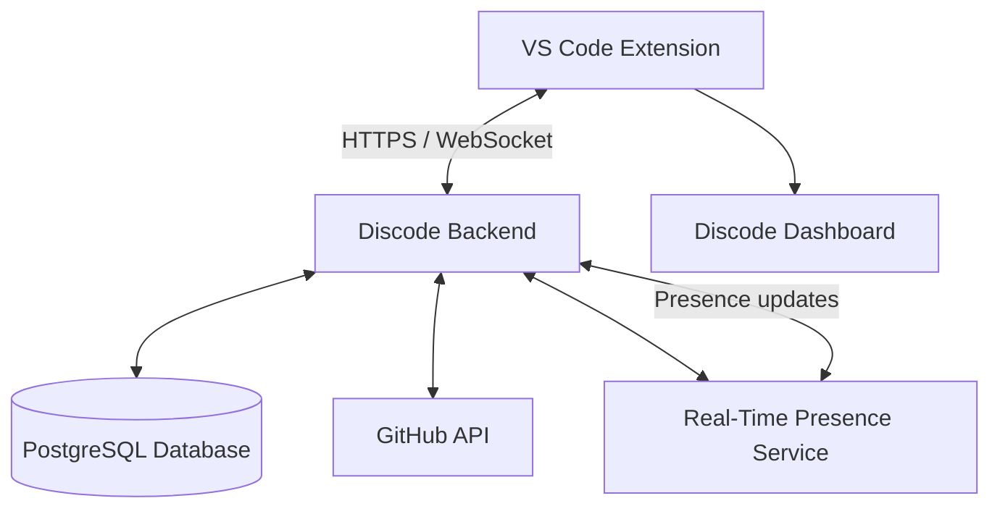

# Discode

### Developer Presence for VS Code

**Know when your friends are coding.**

Discode is a VS Code extension that aims to bring developer discovery, social connections, and real-time presence into the coding environment. Using GitHub as the identity provider, Discode is designed to help developers find one another, build a network of coding friends, and see when those friends are online or open to collaboration — without leaving VS Code.

> **Project status:** Early development / prototype. GitHub authentication and the initial extension interface are implemented. The backend now has an Express/PostgreSQL foundation; backend-powered social features and cross-user real-time presence remain planned.

---

## The Idea

Discode takes inspiration from the social experience of Discord and brings it directly into Visual Studio Code.

A developer signs in using GitHub. Their GitHub username becomes their Discode identity. They can then search for other GitHub developers, connect with people already using Discode, and invite developers who have not joined yet.

Once connected, friends will be able to see one another's availability and permitted coding activity through the VS Code interface. A lightweight notification system will make it possible to know when a friend comes online or becomes available to collaborate.

**The goal is to make coding feel less isolated and make developer collaboration easier to discover.**

## Planned Features

### 1. GitHub Authentication

- Sign in through VS Code's built-in GitHub authentication provider.
- Use the authenticated GitHub account as the user's Discode identity.
- Retrieve relevant public profile information.
- Avoid creating a separate username and password system.

### 2. Developer Discovery

Search for developers using their GitHub usernames.

| Search result | Expected behaviour |
|---|---|
| GitHub user is registered on Discode | Display their Discode profile and allow a friend request |
| GitHub user exists but is not on Discode | Offer an invitation to join |
| GitHub user does not exist | Display a user-not-found result |

Discode will use GitHub's supported APIs for public user search and profile lookup. It will maintain its **own user registry** to identify which GitHub accounts have registered on Discode; GitHub does not provide an unrestricted downloadable database of every username.

### 3. Friends and Connections

- Send, receive, accept and reject friend requests.
- Maintain a friends list inside the Discode dashboard.
- Remove existing connections.
- Show friends' availability and permitted activity.

Friend relationships will be managed by Discode rather than inferred from GitHub followers.

### 4. Developer Presence and Status

Discode is intended to support the following statuses:

| Status | Meaning |
|---|---|
| Online | Available and active in VS Code |
| Idle | Inactive for a configurable period |
| Focused | Deep work; prefers fewer interruptions |
| Open to Contribute | Available for collaboration |
| Offline | Not connected to Discode |

Users should be able to select a status manually, while automatic activity detection provides supporting presence information. Manual status and connection state should remain distinct.

### 5. Coding Activity

With user permission, Discode may display lightweight activity such as:

- Whether a friend is actively coding.
- Current programming language.
- Current filename.
- Workspace or project name.

Privacy is a core requirement: Discode should not share source code, full local file paths, or private workspace information by default. Activity visibility should be configurable.

### 6. VS Code Notifications

Native VS Code notifications are planned for relevant friend activity, such as:

- A friend coming online.
- A friend becoming available to contribute.
- A relevant presence change.

Notifications should be configurable and dismissible so that Discode does not interrupt focused work.

### 7. Discode Dashboard

The dashboard is the central social interface inside VS Code. The planned dashboard will bring together:

- GitHub profile and Discode identity.
- Current status selector.
- Friends list and online indicators.
- GitHub username search.
- Incoming and outgoing friend requests.
- Invitation actions.
- Privacy and notification settings.

---

## Current Implementation

The project is currently an early-stage VS Code extension prototype.

### Implemented

- [x] TypeScript-based VS Code extension scaffold.
- [x] GitHub authentication using VS Code's built-in authentication API.
- [x] GitHub username, numeric account ID, avatar and profile retrieval.
- [x] Use of the numeric GitHub account ID as the stable identity key; usernames are display/search values.
- [x] Login, local sign-out, session restoration and authentication-provider change handling.
- [x] Expired-session handling that signs the user out and requests reauthentication.
- [x] Reusable Discode dashboard opened through `discode.openDashboard`.
- [x] Status bar presence item.
- [x] Detect active editor usage, inactivity-to-Idle transitions, and VS Code focus loss.
- [x] Manual Focused and Open to Contribute overrides, stored separately from automatic activity.
- [x] Modular extension structure separating authentication, commands, services, models and UI.
- [x] Initial presence-status definitions, including Online, Idle, Focused and Open to Contribute.
- [x] Local presence tracking groundwork.

### In Progress / Needs Integration

- [ ] Finalize the dashboard experience and connect all UI states to extension services.
- [ ] Synchronize automatic and manual presence with the backend.
- [ ] Establish the backend contract and connect the extension to it.
- [ ] Define persistent Discode user registration and identity verification.

### Planned

- [x] Backend Express API foundation, PostgreSQL connection configuration, and database health endpoint.
- [x] GitHub-verified sign-in that creates or updates a Discode account using the numeric GitHub ID.
- [ ] Backend user API and PostgreSQL schema/migrations.
- [ ] Discode user registration and profile persistence.
- [ ] GitHub username search and public profile discovery.
- [ ] Registered-user detection and invitation flow.
- [ ] Friend requests and connection management.
- [ ] Real-time online/offline presence across users.
- [ ] Manual status selection and synchronization.
- [ ] Privacy-controlled coding activity sharing.
- [ ] Real-time friend notifications.
- [ ] Dashboard redesign and account settings.
- [ ] Testing, packaging and eventual Marketplace release.

> **Status note:** The checklist reflects the current project baseline. A local status model or tracker does not mean that friends can already see one another's presence. Cross-user functionality requires the backend and real-time service.

Automatic presence initializes with the extension and detects editor activity and VS Code focus locally. After five minutes without editor activity, or when VS Code loses focus, activity becomes Idle. When no editor is active or the extension shuts down, its local presence becomes Offline and pending idle timers are cleared. Selecting Focused or Open to Contribute sets a separate manual override while the extension is active; choosing Automatic returns to the activity-derived Online/Idle state.

---

## Technical Direction

The extension is being developed with a modular architecture so that authentication, presence, dashboard UI and future social features can evolve independently.

| Layer | Planned technology | Responsibility |
|---|---|---|
| VS Code extension | TypeScript, VS Code Extension API | Authentication, editor integration, commands and notifications |
| Dashboard | VS Code Webview; React as a future option | Social interface and user interactions |
| Backend | Node.js, Express | User registration, profiles, friend relationships and API |
| Database | PostgreSQL | Persistent users, connections and preferences |
| Real-time service | Socket.IO / WebSockets | Presence and activity synchronization |
| Identity and discovery | GitHub Authentication API and GitHub REST API | Authentication and public profile lookup |

### High-Level Architecture



The GitHub authentication provider establishes the user's identity in the extension. The backend must independently verify the identity presented by the extension before creating or accessing a Discode account. The backend then manages Discode-specific data, while the real-time service distributes presence updates to authorized friends.

GitHub usernames can change, so the numeric GitHub account ID is the stable identity key. The username and other profile fields are presentation data, not account keys. Signing out of Discode clears the extension's local authenticated state; the GitHub account itself remains signed in to VS Code.

The backend directory now contains the Express API, PostgreSQL connection pool, environment configuration, local Compose database, database-aware health route, a users-table migration, and GitHub-verified account registration/sign-in. Friend/social APIs and real-time infrastructure are not yet implemented.

See [backend/README.md](./backend/README.md) for backend setup and development commands.

---

## Development Roadmap

Development will proceed incrementally, preserving the working extension while introducing the backend and social features.

| Phase | Scope | Status |
|---|---|---|
| 01 | GitHub authentication and identity | Implemented groundwork |
| 02 | Backend integration and user registration | Planned |
| 03 | GitHub username search and developer discovery | Planned |
| 04 | Friend requests and social connections | Planned |
| 05 | Real-time online/offline presence | Planned |
| 06 | Custom statuses and activity detection | Local groundwork; synchronization planned |
| 07 | VS Code notifications | Planned |
| 08 | Dashboard improvements, privacy controls and polish | Ongoing / planned |

Phases may overlap as implementation and testing progress. The roadmap will be updated as features are completed and verified.

---

## Project Structure

The extension currently follows a modular TypeScript structure.

```text
src/
├── auth/
│   └── AuthManager.ts
├── backend/
│   ├── src/
│   └── test/
├── commands/
│   └── CommandManager.ts
├── core/
│   └── ExtensionController.ts
├── gitHub/
│   └── GithubService.ts
├── models/
│   ├── GitHubUser.ts
│   ├── PresenceStatus.ts
│   ├── StatusBarState.ts
│   └── user.ts
├── presence/
│   └── presenceTracker.ts
├── services/
│   ├── GitHubService.ts
│   └── PresenceManager.ts
├── ui/
│   └── StatusBarManager.ts
├── webview/
│   └── DashboardView.ts
└── extension.ts
```

The structure may evolve as the dashboard and backend integration grow. The backend is expected to become a separately organized component rather than placing server responsibilities inside the VS Code extension.

---

## Running the Extension Locally

### Prerequisites

- [Node.js](https://nodejs.org/)
- npm
- [Visual Studio Code](https://code.visualstudio.com/)
- GitHub account

### Setup

```bash
# Clone the repository
git clone <repository-url>

# Enter the project directory
cd discode

# Install dependencies
npm install

# Compile the extension
npm run compile
```

### Launch

1. Open the project folder in VS Code.
2. Press `F5` to launch the Extension Development Host.
3. Open the Command Palette.
4. Run **Discode: Open Dashboard**.
5. Sign in with GitHub when prompted.

### Available Scripts

| Command | Purpose |
|---|---|
| `npm install` | Install project dependencies |
| `npm run compile` | Compile TypeScript |
| `npm run watch` | Watch and compile source changes |
| `npm run lint` | Run ESLint |
| `npm test` | Compile, lint and run extension tests |

---

## Security and Privacy Principles

Discode is designed around minimal and user-controlled presence sharing.

- GitHub authentication tokens must be handled securely and never committed to the repository.
- The backend must verify authenticated identities; a submitted username alone is not proof of ownership.
- Only the minimum profile and presence data required for the service should be stored.
- Users should control which coding-activity details are visible to friends.
- Source code and full local file paths must never be transmitted as presence data.
- Real-time connections and backend communication must use secure transport.
- Users should be able to control notifications and activity visibility.
- Account deletion and associated data removal must be supported when the backend is introduced.

---

## Current Focus

The immediate priority is to move from a locally functioning extension prototype to a connected Discode service.

**Next major milestone:** establish the backend, define the user identity and registration flow, and connect the existing extension to persistent Discode accounts.

Features will be marked complete only after they are implemented and tested, not merely designed.

---

## Project Status

Discode is actively being developed. The current repository represents an evolving prototype, and the planned architecture and feature set may change as implementation progresses.

**Built for developers, by developers.**